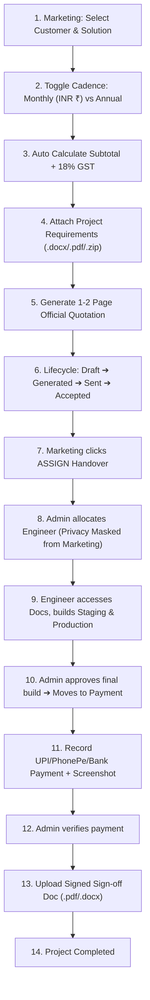

# Smart Pricing Calculator & Enterprise Management Portal (Final Release)
### Aivontraa Automation Pvt. Ltd.
**Website**: [www.aivontraa.com](https://www.aivontraa.com)  
**Root Administrator**: `laxminivasmorishetty143@gmail.com` (Supports Multiple Admin Emails)  
**Official Logo**: `https://aivontraa.com/assets/images/ai.png` (clean white background)

A clean, modern, fully responsive SaaS platform built with **modular HTML, CSS, and Vanilla JavaScript** frontend, backed by a **Python Flask REST API** and persistent **JSON database (`database.json`)** with data encryption at rest.

---

## 🌟 Key Features & Architectural Upgrades

### 1. Application Layout & Sidebar
- **Completely fixed non-scrollable left sidebar**: The left navigation bar remains completely locked throughout the application and does NOT scroll vertically or horizontally.
- **Independently scrollable main content**: All page contents, dashboards, and tables scroll independently within `.main-wrapper`.
- **Fully responsive**: Supports mobile and tablet devices with an off-canvas drawer and backdrop overlay.

### 2. Company Branding
- Complete migration to **Aivontraa Automation Pvt. Ltd.**
- Official company logo rendered in a dedicated white background container (`.brand-logo-card`).
- Corporate credentials:
  - CIN: `U72900DL2026PTC001234`
  - GSTIN: `36AAICA1234F1Z9`
  - Email: `sales@aivontraa.com`
  - Website: `www.aivontraa.com`

### 3. Pure Google Authentication (Google-Only)
- Username and password authentication **completely removed**.
- Staff authenticate exclusively through **Google Sign-In**.
- Role-based automatic redirection:
  - Administrators (`laxminivasmorishetty143@gmail.com`, `admin@aivontraa.com`, and configured co-admins) ➔ `/admin`
  - Marketing Team Members ➔ `/marketing`
  - Engineering Specialists ➔ `/developer`

### 4. Integrated Price Calculator & Quotation Workflow
- Integrated directly into quotation creation (no standalone disjointed module).
- Select customer and solution category (preserves 7 solution categories with benchmark URLs).
- **Billing Cadence Switcher**: Toggle between **Monthly (in INR ₹)** and **Annual** pricing.
- **Itemized GST (18%)**: Automatically calculates Subtotal, GST @ 18%, and Total Quotation Amount.
- Professional **1–2 page printable quotation document** with official white logo, benchmark links, terms, and signatures.

### 5. Document Uploads (.docx, .pdf, .zip <= 500 KB)
- Marketing executives attach requirements and branding files directly to quotations and projects.
- Supported formats: **Microsoft Word (`.docx`)**, **PDF (`.pdf`)**, and **Compressed archives (`.zip`)**.
- Strictly enforces 500 KB maximum file limit.
- Developers access uploaded documents immediately upon sprint assignment.

### 6. Strict Quotation Lifecycle & Audit Retention
- Strict lifecycle progression:
  `Draft` ➔ `Generated` ➔ `Sent to Customer` ➔ `Accepted` ➔ `Rejected`
- **Permanent retention**: Quotations **cannot be deleted**, preserving historical audit trail.
- When quotation is `Accepted`, the **ASSIGN** button enables to initiate engineering handover.

### 7. Critical Engineering Privacy Rule
- **Strict Privacy Rule**: The marketing team must **NOT** see the engineering employee's name or contact details.
- When assigned, marketing sees: `"Engineering Team Assigned"` or `"In Engineering"`.
- Developer identity is visible exclusively to the Root Administrator.

### 8. Admin Project Assignment Management Panel
- Dedicated panel in Admin Portal (`/admin/assignments`).
- Tracks all accepted quotations awaiting developer allocation.
- Developer workload and availability tracker (*Available* vs *Busy*).
- Project start and expected completion date scheduling.

### 9. Marketing Team Multiple Responsibilities
- Administrators can assign multiple concurrent job duties to marketing members:
  - `Marketing Executive`
  - `Client Communication`
  - `Payment Collection`
  - `Customer Follow-up`
  - `Requirement Collection`
  - `Documentation`
  - `Project Coordination`
  - `Other Responsibilities`
- Includes a quick **"Select ALL (Excludes Admin)"** option.
- Administrator role remains strictly exclusive to designated administrators (e.g. `admin@aivontraa.com`).

### 10. Payment Verification & Final Sign-Off
- Active after quotation acceptance.
- Itemized payment record: Subtotal, GST 18%, Total Amount, Amount Paid, Payment Methods (*PhonePe, UPI, Bank Transfer*), and Screenshot proof upload.
- Admin verifies/rejects transactions.
- **Final Sign-off Document Upload**: Requires upload of signed sign-off certificate (`.pdf` or `.docx`).
- **Strict Delivery Gate**: Project completion is strictly blocked until payment is verified and sign-off document is uploaded.

### 11. Change Request Management
- Marketing can submit revision requests with scope files (`.docx`, `.pdf`, `.zip` <= 500 KB).
- Synchronized directly to developer workspace for milestone resolution.

### 12. Enterprise Multi-Module Sharded Database Architecture
- **17 Module Directories**: Data is partitioned into dedicated modular directories:
  `/database/{admin, users, customers, leads, quotations, projects, marketing, engineering, assignments, payments, invoices, change_requests, documents, notifications, audit_logs, backups, system}`.
- **Sequential Storage Shards**: Shards named sequentially (e.g. `customers_001.db`, `customers_002.db`, `quotations_001.db`).
- **Controlled Rotation Logic**: Automatically triggers rotation to a new sequential active shard when the current file reaches **~70 MiB (soft limit)**, strictly preventing any shard from exceeding the **100 MiB hard limit**.
- **Central Master Catalog (`/database/system/master_catalog.db`)**:
  - Maintains `shard_registry`, `record_index`, `cross_module_relationships`, and `audit_trail`.
  - Enables $O(1)$ indexed primary key lookups across all shards.
  - Foreign key cross-module integrity graphs (Quotes $\leftrightarrow$ Projects $\leftrightarrow$ Customers $\leftrightarrow$ Payments $\leftrightarrow$ Invoices).
- **Cryptographic Encryption at Rest**: All payload records encrypted using **Fernet AES-256-GCM** with cryptographic HMAC-SHA256 checksums verified on every read.
- **Data Management Dashboard**: Interactive storage dashboard in Admin Portal (`/admin/database`) with:
  - Real-time storage gauges and capacity meters.
  - Per-module storage breakdown cards.
  - Active vs Archived shard file tables.
  - 1-Click Integrity Checks (`PRAGMA integrity_check` + HMAC).
  - 1-Click Database Optimization (`VACUUM` & `ANALYZE`).
  - Automated compressed backups in `/database/backups/`.
  - Simulated growth & live rotation testing.
- **Permanent Data Integrity**: Never automatically deletes customer records, quotations, payments, or projects to reclaim storage.

---

## 🚀 Quick Start

### 1. Start Application Server
```bash
python app.py
```
Open browser at:
```
http://localhost:5000
```

---

## 🔐 Authorized Google Accounts (1-Click Test Simulation)

| Role | Name | Google Account Email | Permitted Portal |
| :--- | :--- | :--- | :--- |
| **System Administrator (Root)** | Laxminivas Morishetty | `laxminivasmorishetty143@gmail.com` | `/admin` |
| **System Co-Administrator** | Aivontraa Administrator | `admin@aivontraa.com` | `/admin` |
| **Marketing Lead** | Rajesh Kumar | `rajesh.marketing@aivontraa.com` | `/marketing` |
| **Client Communication & Sales** | Priya Sharma | `priya.sales@aivontraa.com` | `/marketing` |
| **Operations & Payments** | Vikram Singhania | `vikram.ops@aivontraa.com` | `/marketing` |
| **Engineering Specialist (Dev)** | Arundhaya | `arundhaya.dev@aivontraa.com` | `/developer` |
| **UI/UX Engineer (Dev)** | Sneha Patel | `sneha.dev@aivontraa.com` | `/developer` |

---

## 🔄 Complete End-to-End Business Flow


